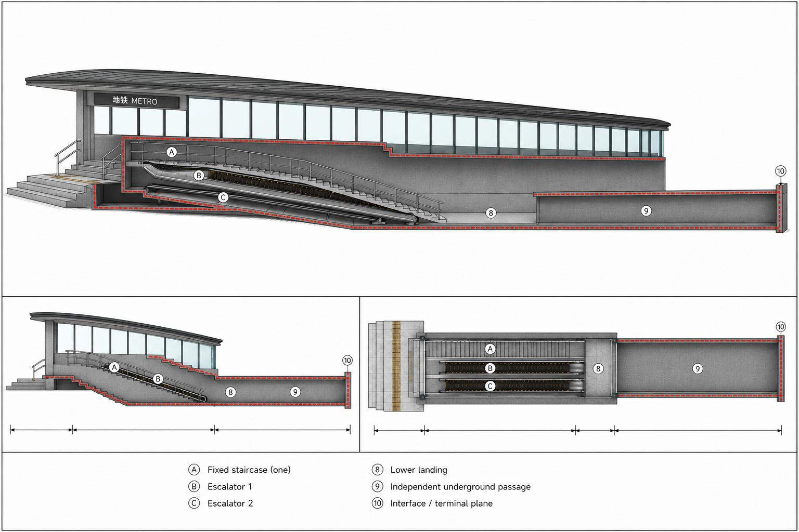

# Phase 18D-3 精细化地铁入口批准基线

日期：2026-08-09
状态：用户已批准，作为后续精细化地铁入口建模的唯一视觉与拓扑基线
适用资源：`subway_entrance_detailed_building`

## 1. 批准图



- 文件：`docs/assets/phase18d/subway_entrance_cn_generic_A_approved_2026-08-09.png`
- 像素：1536 × 1024
- SHA-256：`9D372CBF379A141ED0483A58B8BC0E086DFB37F27E97F114B536638F4067CD15`
- 视图解释优先级：平面图决定拓扑，纵剖面决定竖向关系，轴测图仅用于外观与构造表达。

## 2. 锁定的空间拓扑

从地面入口到接口面必须保持一条连续直线：

```text
                                    ┌─ A：一组固定楼梯 ─┐
地面入口 -> 共用上部平台 -> 并排同向 ├─ B：第一组自动扶梯 ├-> 8：共用全宽下部平台
                                    └─ C：第二组自动扶梯 ┘
       -> 9：一段独立、笔直、空腔式地下通道
       -> 10：与未来站厅或外部模型连接的接口面
```

A、B、C 是横向并排、纵向同向的三个交通带，不是前后串联。必须恰好生成一组固定楼梯和两组自动扶梯。8、9、10 与三个交通带保持同一纵轴，不允许 90° 转弯、侧向支路、错位连接或在本资产内生成站厅。

## 3. 锁定的地面建筑形态

- 采用长条形、低矮、通透的中国常见地铁入口亭体。
- 连续浅弧金属屋面覆盖完整下行段，入口端形成挑檐。
- 两侧采用规则分格的玻璃围护，玻璃下部设置实体基座或混凝土坎墙。
- 入口端采用简洁门架、宽台阶、栏杆和必要的防滑/盲道构造。
- 识别系统只保留可替换的通用“地铁 METRO”占位模块；默认资源不得写入具体城市标志、站名、线路号或出入口编号。

## 4. 后续实体化建模边界

- 地下下行段、下部平台和独立通道采用真实空腔 RC 箱体，不得把通行空间填成实体。
- RC 底板、侧墙、顶板、楼梯及需要承载的基座使用 Solid；对应钢筋使用 Beam/钢筋网格，并建立可审核的嵌入或耦合关系。
- 地面亭体的柱、梁和屋面支承独立于地下 RC 箱体建模；玻璃、金属屋面和非承重饰面使用独立 Shell/面板角色，不得静默套用混凝土材料。
- 自动扶梯作为两套彼此独立的设备组件建模，至少分离桁架/导轨、梯级带、栏板与扶手角色；不得把扶梯误当作 RC 实体，也不得生成第三套扶梯。
- 允许 `full_reinforced`、`concrete_only` 和按角色关闭钢筋/设备细节，但关闭某类内部构件不得改变空腔、洞口和主结构几何。

## 5. 参数化要求

批准图锁定拓扑和建筑语言，不把图片比例直接当作工程尺寸。后续设计窗口至少应允许用户审核或覆盖：

- 亭体长度、宽度、净高、屋面弧高、入口挑檐和玻璃分格；
- 固定楼梯净宽、踏步、坡度和休息平台；
- 两组扶梯的宽度、倾角、提升高度及设备包络；
- 上部平台、下部平台的长度和净宽；
- 地下通道长度、净宽、净高以及底板、侧墙、顶板厚度；
- RC 材料、钢筋材料、保护层、纵筋、分布筋和局部加密；
- 钢亭材料、玻璃与屋面面板材料、连接简化等级和网格档位。

所有工程尺寸在进入可求解项目之前，必须依据项目所在地、设计客流、消防疏散、防淹、无障碍、设备厂家包络及现行国家/地方规范复核；批准图本身不构成规范符合性证明。

## 6. 实施与兼容边界

- 本基线只替代 Phase 18D-3 的精细化地铁入口设计，不修改任何既有轻量地铁入口资源的 ID、几何、调用接口或默认行为。
- 不接入或修改其他场景生成器；后续精细化工况只消费本资产编译结果。
- 当前仅固化设计资产和约束，暂停状态下不恢复 Phase 18D-3 生产代码实施。

## 7. 后续验收条件

1. 生成结果中固定楼梯数量必须为 1、自动扶梯数量必须为 2。
2. 平面拓扑必须为 `A/B/C -> 8 -> 9 -> 10` 的同轴直通关系。
3. RC 通行空间、下部平台与地下通道中心探针不得落入 Solid。
4. `full_reinforced` 下需要配筋的 RC 构件同时存在 Solid、钢筋 Beam 和闭合关系；`concrete_only` 下仅移除钢筋及其关系。
5. 地面钢亭、玻璃、金属屋面、设备与地下 RC 构件拥有独立 Part/Section/Material 角色。
6. 三视图预览与批准图的建筑语言和拓扑一致，且不出现额外楼梯、额外扶梯、转弯通道或站厅。
7. 输出继续标记 `requires_project_review=true`，直至真实 LS-PrePost 导入、材料审核、网格敏感性和 LS-DYNA 工程验证完成。
