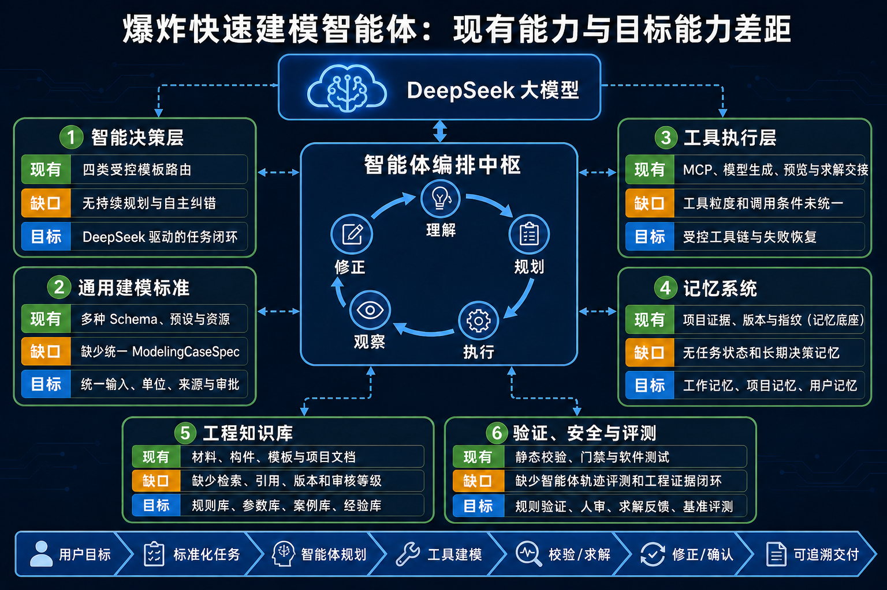
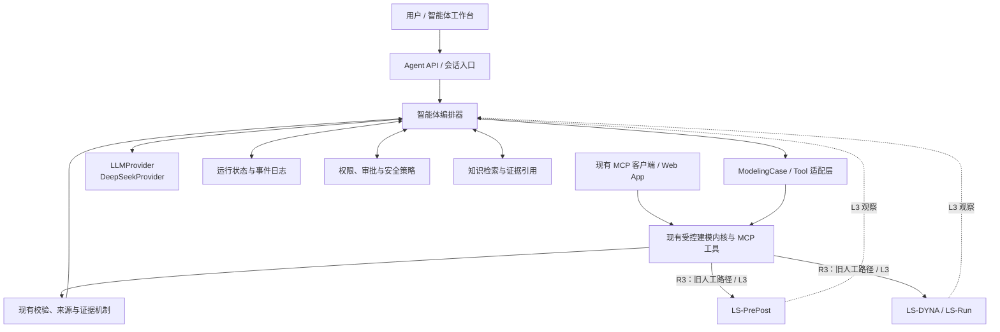

# 爆炸快速建模智能体化设计

日期：2026-08-15
状态：用户已审阅通过（2026-08-22）
适用范围：`lsprepost-mcp` 现有受控建模、校验、预览、LS-PrePost/LS-DYNA 交接能力之上的增量智能体层
首选大模型：DeepSeek，采用供应商无关适配接口
目标等级：L2 工作流智能体；L3 求解闭环作为后续扩展

## 1. 文档目的

本设计把现有“用户或外部 AI IDE 调用 MCP 工具”的项目，增量升级为“能够理解目标、补齐信息、制定计划、调用工具、检查结果、请求确认并从中断处恢复”的爆炸快速建模智能体。

本设计不是实施计划。它先固定系统边界、数据合同、兼容策略、记忆机制、知识库、DeepSeek 接入方式、安全门禁和验收口径。用户审阅通过后，再单独编写分阶段实施计划。

核心结论如下：

1. 智能体作为旁路新增层接入，不替换现有 MCP、Web App、模型生成器或项目格式。
2. 首先建立统一 `ModelingCaseSpec`，再接入 DeepSeek；大模型不能直接编写 LS-DYNA keyword。
3. 记忆采用结构化状态、项目决策和显式用户偏好三层模型，不把聊天上下文或供应商缓存当作持久记忆。
4. 知识库分为权威规则、参数资源、审核案例和经验提示四类；任何重要建议必须带来源、版本和审核状态。
5. 所有工程结论继续区分软件校验、求解证据和工程审核，智能体不能自行提升工程验证等级。

能力差距总览见：



## 2. 当前项目基线

### 2.1 已有能力

当前项目已经具备较完整的确定性工程软件底座：

- MCP JSON-RPC 服务、工具注册表和输入 schema 校验。
- 受控模型、构件、材料、结构资源、场景和爆炸工况生成能力。
- `model.json`、`model.k`、`checks.json` 等项目产物。
- 模型静态验证、readiness 门禁、资源闭包、关键字质量检查和来源验证。
- LS-PrePost 打开、预览导出、LS-DYNA/LS-Run 交接及部分求解结果解析。
- 项目锁、临时目录、原子提交、版本化写入、归档和指纹机制。
- 运行证据清单、文件哈希和结果身份校验。
- Web App、活动项目目录、运行数据目录和正式资源目录的明确边界。
- Phase 18 建筑资源、精细建筑和精细爆炸工况仍在持续演进。

这些能力应继续作为确定性内核。智能体只负责组织和选择这些能力，不复制建模实现。

设计基线时，现有 `TOOLS` 注册表包含 44 个 MCP 工具。Phase 18A–D 已存在公开 Python 资源/建筑接口，但其中部分能力尚未进入 MCP 或 Web；Phase 18E/F 已有批准设计和实施计划，当前主工作区尚不存在计划中的 `refined_blast/` 生产包、Web 适配层和对应测试。因此本设计不能把 Phase 18E/F 叙述为已上线能力。

现有 `generate_scene_from_prompt` 仍是四种受控自然语言模板，不是开放式任意建模器。智能体新增对话能力只能路由到能力目录明确支持的场景；未知工况必须追问、拒绝或标记未支持，不能借大模型扩大底层实际能力。

当前 MCP Server 是同步 stdio JSON-RPC 进程，工具注册项主要包含描述、输入 schema 和处理函数；风险、审批、幂等和副作用不是现有注册表的一等元数据。现有 JSON Schema 入口只覆盖部分结构约束，数值范围、数组规模和领域关系仍由各领域处理函数负责。因此智能体不能仅凭 MCP schema 判断调用安全，也不能把工具名称中的 `read`、`validate` 等词当作无副作用保证。

### 2.2 当前不具备的智能体能力

当前仓库尚未形成以下完整闭环：

- 项目内的大模型供应商适配层。
- 可恢复的智能体运行状态与状态机。
- 从用户目标到结构化建模任务的统一顶层合同。
- 缺失参数追问、计划生成、工具执行、观察和修正循环。
- 受控的长期记忆写入与读取策略。
- 带引用、版本、适用范围和审核等级的知识检索层。
- 面向智能体行为轨迹的基准评测、回放和回归机制。

### 2.3 必须保持的事实边界

以下状态必须相互独立，不得被智能体合并为一个“成功”结论：

| 状态 | 含义 | 智能体权限 |
| --- | --- | --- |
| `software_validated` | schema、引用、文件、规则和软件流程检查通过 | 可由确定性校验器产生 |
| `solver_executed` | 目标求解器确实执行并产生可验证证据 | 只能由运行证据产生 |
| `result_checked` | 指定结果文件完成解析和质量检查 | 只能由结果处理流程产生 |
| `engineering_reviewed` | 材料、网格、边界、试验/文献对照和工程解释通过审核 | 只能由授权工程人员确认 |

大模型不得直接写入或提升上述状态。

## 3. 目标与非目标

### 3.1 第一目标：L2 工作流智能体

首版智能体应能够：

1. 接收用户的爆炸建模目标。
2. 识别场景、已知参数、缺失参数和冲突参数。
3. 将需求规范化为 `ModelingCaseSpec`。
4. 基于能力目录、规则和知识检索提出可解释的建模方法候选。
5. 向用户逐项追问关键缺失信息。
6. 在用户确认后生成结构化执行计划。
7. 按权限调用现有受控工具。
8. 读取工具结果和校验发现，进行有限重试或提出修正方案。
9. 识别覆盖、归档、GUI、求解和工程判断等高风险请求；L2 MVP 拒绝或交接未开放动作，仅对其支持范围内的写操作发起明确批准。
10. 保存状态，并能在程序中断或会话结束后恢复。
11. 输出模型、假设、未验证项、来源、版本和审计轨迹。

### 3.2 后续目标：L3 求解闭环

L3 在 L2 稳定后增加：

- 经逐次授权启动 LS-DYNA。
- 监控运行状态和资源使用。
- 解析失败原因、求解警告和指定结果指标。
- 基于确定性策略提出修正候选。
- 经用户批准生成新版本并重新求解。

L3 不在首版完成定义中。

### 3.3 明确非目标

- 不训练或微调基础大模型。
- 不在首版实现多智能体协作。
- 不允许大模型直接生成、编辑或覆盖 `.k`、`.key`、`.dyn`。
- 不自动采用未审核材料、炸药、本构、侵蚀或失效参数。
- 不自动把一次对话或一次成功模型提升为权威知识。
- 不替换现有 Web App、MCP 工具、模型生成器、项目存储或校验器。
- 不为智能体化而重构与智能体无关的既有领域模块。
- 不把软件验收描述为工程验证。

## 4. 方案比较与选择

### 4.1 方案 A：把智能体逻辑直接写入现有 MCP 服务

优点是调用路径短，初期文件较少。缺点是大模型、会话状态和既有确定性工具耦合，容易改变 MCP 启动行为、工具契约和测试边界，不利于当前项目继续优化。

### 4.2 方案 B：新增旁路智能体领域层，复用现有公共工具

智能体拥有独立的合同、状态、知识、策略和 API，通过显式工具适配器调用当前 MCP/领域公共接口。旧用户仍可直接使用 MCP 或 Web App。

该方案兼容性最好，允许独立关闭、回退、测试和替换大模型，因此作为本设计的固定方案。运行形态采用同仓库、独立本地进程：智能体运行服务不嵌入现有同步 stdio MCP Server，Web/MCP 只提供薄入口。

### 4.3 方案 C：完全独立的外部智能体服务

隔离最强，也适合未来远程部署，但首版会增加进程管理、认证、部署和版本协商成本。保留为后续部署形态；首版采用同仓库独立领域包，接口边界按可拆分服务设计。

## 5. 总体架构



设计保持两条可独立工作的路径：

```text
旧路径：用户/AI IDE → 现有 MCP 或 Web App → 现有建模内核

新路径：用户 → 智能体 → 标准化任务 → 受控工具适配器 → 现有建模内核
```

关闭智能体功能后，旧路径的启动、工具列表、schema、默认值、项目文件和输出必须保持基线一致。

智能体内部按三平面隔离：

- 模型平面：DeepSeek 等 `LLMProvider`，只能提出问题、计划和动作候选。
- 控制平面：状态机、策略、审批、预算、幂等和恢复，是唯一决策权威。
- 执行平面：受控工具网关、现有建模内核、校验器和求解接口，拒绝大模型直接访问文件或进程。

首版 `agentd` 仅监听 `127.0.0.1`，作为状态单写者运行。现有 MCP stdio 和 Web 直连路径继续兼容运行；因此首期智能体门禁只保证经 Agent 路径执行的动作，不反向改变旧入口的授权语义。

## 6. 建议代码与数据边界

### 6.1 新增源码边界

智能体代码进入独立领域包：

```text
lsprepost_mcp/
  agent/
    contracts.py          # ModelingCaseSpec、AgentDecision 等闭合集合同
    state.py              # AgentRunState 与状态转换
    events.py             # 追加事件与审计字段
    orchestrator.py       # 确定性状态机
    planner.py            # LLM 决策请求与结果规范化
    policy.py             # 工具权限、审批和敏感数据策略
    tool_catalog.py       # 现有工具能力快照和显式允许列表
    tool_adapter.py       # ModelingCaseSpec 到现有工具输入的适配
    memory.py             # 工作、项目和用户记忆接口
    knowledge.py          # 检索、引用和冲突处理接口
    evaluation.py         # 轨迹回放和基准评测
    runtime.py            # 独立本地智能体运行服务
    providers/
      base.py             # LLMProvider 接口
      deepseek.py         # DeepSeek 实现
  web/
    agent_api.py          # 可选的 /api/agent/v1 入口
```

智能体包只能依赖现有稳定公共接口和显式适配器，不得从 Phase 18 或其他领域包导入私有函数。独立运行服务可以和现有 Web App 共享受控领域接口，但不能接管现有 MCP stdio 主循环。

### 6.2 新增运行数据边界

```text
workspace/
  agent/
    agent.sqlite3
    runs/<run_id>/
      run.json
      events.jsonl
      snapshots/
      exports/
    private_sources/
```

这些内容是本地运行数据，不进入版本管理或分发包。

事实源层级固定为：

- 现有项目目录仍是模型、检查和求解证据的事实源。
- `resources/` 中已审核 JSON/载荷是共享知识与参数事实源。
- `workspace/agent/agent.sqlite3` 是智能体运行状态、事件和记忆的事务事实源。
- `run.json`、`events.jsonl` 和 `snapshots/` 是从 SQLite 生成的可读审计/恢复导出，不构成第二个可独立修改的事实源。
- `knowledge_index` 和 FTS 数据均可从资源与私有来源重建，不得反向覆盖原始资源。
- Agent delivery package 中冻结的 `knowledge_snapshot.json` 是解释其所引用项目知识版本的不可变证据；它不注入或改变旧项目格式。

### 6.3 新增受控资源边界

```text
resources/
  knowledge/
    catalog.json
    rules/
    cases/
    manifests/
  schemas/
    agent/
```

现有 `resources/materials/`、模型库、结构资源和审核清单继续作为参数与模型资源事实源；智能体知识层只建立引用和可重建索引，不复制这些正文。只有许可证允许分发、来源完整并经过审核的规则与脱敏案例进入 `resources/knowledge/`。受限手册、企业资料和用户私有数据保留在 `workspace/agent/private_sources/`，版本库只保存允许公开的引用元数据。

## 7. 通用建模标准 `ModelingCaseSpec`

### 7.1 定位

`ModelingCaseSpec` 是用户语言、智能体决策和现有建模工具之间的稳定中间合同。首版 schema 固定为：

```text
schema_version = "blast_modeling_case@1"
```

它不替换现有 `ModelSpec`、Phase 15/16/18 合同或项目 schema。每种受支持场景通过版本化适配器从 `ModelingCaseSpec` 转换为对应现有输入。

规范 schema 必须作为版本化资源提交到：

```text
resources/schemas/agent/blast_modeling_case@1.schema.json
resources/schemas/agent/profiles/<profile_id>@<version>.schema.json
```

基础 schema 和场景 profile schema 均设置 `additionalProperties=false`。Python 合同、DeepSeek response schema、测试夹具和适配器只能由这些规范 schema 生成或逐项对照，不能各自维护不同字段定义。

### 7.2 顶层字段

以下是闭合基础信封的结构示意；具体领域字段由 `scenario.profile_id` 判别的 profile schema 闭合：

```json
{
  "schema_version": "blast_modeling_case@1",
  "case_id": "case_...",
  "goal": {},
  "scenario": {},
  "geometry": {},
  "blast_source": {},
  "structure": {},
  "modeling_method": {},
  "mesh_strategy": {},
  "conditions": {},
  "solver_controls": {},
  "output_requests": {},
  "field_evidence": {},
  "assumptions": [],
  "open_questions": [],
  "review": {},
  "provenance": {}
}
```

基础信封必填：`schema_version`、`case_id`、`goal`、`scenario`、`field_evidence`、`assumptions`、`open_questions`、`review` 和 `provenance`。`scenario` 必须包含 `kind`、`profile_id`、`profile_version` 和 `unit_system`；其余领域对象是否必填、允许哪些字段以及关键字段集合由 profile 决定。

每个 `CaseProfileDescriptor` 必须声明：

```text
profile_id / profile_version
scenario_kind
required_paths / optional_paths / critical_paths
canonical_unit_by_path
collection_identity_and_ordering
adapter_id / adapter_version
required_capabilities
```

MVP 固定发布 `controlled_ale_blast@1`，只映射当前 `generate_ale_blast_demo` 明确支持的输入。外爆、内爆、半封闭、LBE、导入压力时程和未来精细建筑爆炸分别使用其他 profile，不能在同一 profile 中塞入互斥字段。

各部分职责如下：

| 部分 | 内容 |
| --- | --- |
| `goal` | 建模目的、研究对象、输出要求和成功标准 |
| `scenario` | 外爆、内爆、半封闭、接触爆炸等分类及适用范围 |
| `geometry` | 建筑、构件、空间、洞口、地面和爆源空间关系 |
| `blast_source` | 炸药、当量、形状、位置、起爆方式和来源 |
| `structure` | 结构体系、构件、材料、截面、连接和失效能力 |
| `modeling_method` | ALE-FSI、LBE、压力时程等候选和最终选择 |
| `mesh_strategy` | 全局网格、局部加密、流体域网格和规模预算 |
| `conditions` | 接触、耦合、边界、支承和初始条件 |
| `solver_controls` | 终止时间、时间步、控制卡和资源配置 |
| `output_requests` | d3plot、压力、位移、损伤、能量等 |
| `field_evidence` | 每个关键字段的来源、单位、置信和审核状态 |
| `assumptions` | 已显式声明但尚未完成工程验证的假设 |
| `open_questions` | 阻断或非阻断的待补充问题 |
| `review` | 用户确认、工程审批、警告确认和失效状态 |
| `provenance` | schema、适配器、知识和工具版本指纹 |

### 7.2.1 规范化与未知值

- 数值进入语义对象前统一到 profile 指定的 `SI_m_s_kg_N_Pa` 规范单位；原始值和原始单位只保存在证据中。
- 缺失或未知值不使用 `null`、`"unknown"`、NaN 或占位数字；字段保持缺失，并在 `open_questions` 中创建带 `field_path` 的记录。
- 集合型数组按 profile 声明的稳定 ID 排序；时间序列、曲线点和其他有序数组保留物理顺序并验证单调性。
- 每个对象 ID 必须非空且在其命名空间唯一；重复 ID fail-closed。
- `field_evidence` 的 JSON Pointer 必须指向真实字段，或指向 `open_questions` 中明确等待补充的关键路径。

### 7.2.2 指纹

`case_id` 是运行身份，可以随机生成；`recorded_at`、事件时间、trace ID、消息 ID 和展示文案均不进入语义指纹。

- `semantic_fingerprint`：规范 schema/profile 版本、规范化工程字段、资源稳定 ID/版本和集合规范顺序的 canonical JSON SHA-256。
- `revision_fingerprint`：在语义指纹基础上加入证据记录版本/哈希、假设、开放问题状态、审核 decision digest、适配器、策略和 checker 版本；仍排除时间戳和 trace ID。

相同工程输入、profile 和资源版本必须得到相同 `semantic_fingerprint`；审批、执行和恢复绑定 `revision_fingerprint`，避免随机 ID 或时间戳破坏确定性。

### 7.3 字段证据

原始数值保持普通 JSON，来源信息按 JSON Pointer 单独记录，避免破坏现有工具输入：

```json
{
  "/blast_source/tnt_equivalent_kg": {
    "source_kind": "user_input",
    "source_ref": "message:17",
    "unit": "kg_TNT",
    "certainty": "confirmed",
    "review_status": "approved",
    "recorded_at": "2026-08-15T00:00:00Z"
  }
}
```

`source_kind` 只允许：

- `user_input`
- `approved_preset`
- `knowledge_record`
- `existing_project`
- `tool_result`
- `agent_recommendation`

`agent_recommendation` 不得自动视为已确认输入。炸药、材料、本构、失效、侵蚀、边界和关键网格参数缺少合格来源时必须进入 `open_questions` 或审核门禁。

### 7.4 完整性和适用性检查

`ModelingCaseSpec` 进入计划状态前必须通过：

1. schema 和闭合集检查。
2. 单位、有限数、范围和枚举检查。
3. 场景必填字段检查。
4. 空间关系和能力匹配检查。
5. 关键字段来源检查。
6. 建模方法适用条件检查。
7. 未解决冲突和阻断问题检查。

大模型负责提出候选和解释问题；是否通过由确定性代码决定。

## 8. DeepSeek 与大模型适配层

### 8.1 供应商无关接口

`LLMProvider` 至少提供：

```text
capabilities()
create_decision(request, response_schema)
summarize_context(events, budget)
health_check()
```

能力协商至少声明原生工具调用、JSON 模式、流式、并行工具调用、思考模式、上下文上限和输出上限。供应商错误统一分类为认证、限流、超时、服务不可用、上下文超限、空响应、截断、非法 JSON 和未知响应。

首个实现为 `DeepSeekProvider`。MVP 默认使用 DeepSeek 云端 API；模型名、基础地址、思考模式、超时和重试配置化，不写死在领域代码中。本地 DeepSeek 或其他 OpenAI 兼容服务以后通过同一接口接入。

MVP 的工具决策请求明确禁用思考模式，并把每个 `AgentDecision` 当作独立供应商事务；执行结果由控制平面写入下一轮公开状态摘要，不续接供应商内部工具会话。这避免把 `reasoning_content` 变成恢复依赖。

未来若为分析请求启用 DeepSeek 思考模式，供应商要求续轮回传的 `reasoning_content` 只允许在当前进程内、当前 provider continuation 中短暂存在，不进入 SQLite、JSONL、日志、trace、审批或导出。进程崩溃后丢弃 continuation，基于已提交的公开状态重新生成决策，不恢复或伪造推理内容。

### 8.2 大模型允许承担的职责

- 从自然语言提取候选字段。
- 发现缺失信息并生成清晰问题。
- 在规则允许的候选中提出方法选择。
- 生成结构化计划候选。
- 从允许列表中选择下一项工具。
- 归纳工具结果、校验发现和知识证据。
- 向用户解释假设、风险和下一步。

### 8.3 大模型不得承担的职责

- 直接写 keyword 或修改现有项目文件。
- 绕过 JSON schema、规则校验或权限策略。
- 自行确认关键工程参数。
- 自行批准覆盖、归档、GUI、求解或知识发布。
- 把自然语言判断直接写成工程验证状态。
- 生成或保存隐式推理链作为审核证据。

系统只保存简洁的决策理由、引用、输入摘要和结果，不依赖或持久化模型内部推理过程。

### 8.4 结构化输出与本地复核

DeepSeek 支持 JSON 输出和工具调用，但所有返回仍必须经过本地 schema、枚举、范围、数组规模、跨字段关系、权限和工具参数验证。严格模式属于供应商能力而不是安全边界；智能体侧不能只依赖现有 MCP 入口的部分 JSON Schema 校验。

参考资料：

- [DeepSeek Tool Calls](https://api-docs.deepseek.com/guides/tool_calls)
- [DeepSeek JSON Output](https://api-docs.deepseek.com/guides/json_mode)
- [DeepSeek Thinking Mode](https://api-docs.deepseek.com/guides/thinking_mode)
- [DeepSeek Context Caching](https://api-docs.deepseek.com/guides/kv_cache)

上下文缓存只能降低重复输入成本，不能作为持久记忆或恢复依据。

### 8.5 隐私和失效处理

- API Key 只能来自环境变量或本机秘密存储，不进入配置文件、日志、事件或导出包。
- 默认只向云端发送完成决策所需的结构化摘要，不发送完整 `.k`、求解结果、私有手册或无关项目文件。
- 私有资料进入模型上下文前必须通过数据策略检查。
- 供应商超时、限流、空响应、非法 JSON 或工具幻觉不得触发任何工具执行。
- 可重试错误采用有限指数退避；超过上限后保存状态并返回用户处理。
- DeepSeek 不可用时，现有 MCP 和 Web App 继续正常工作。

## 9. 智能体状态机

### 9.1 状态

`AgentRunState` schema 固定为 `agent_run@1`，状态只允许：

```text
draft
needs_input
ready_to_plan
waiting_plan_approval
executing
validating
needs_repair
waiting_action_approval
waiting_external_result
paused_budget
paused_recovery
cancelling
completed
failed
cancelled
```

快照还必须包含：

```text
run_id / revision / objective
provider_snapshot（不含秘密）
tool_catalog_hash / policy_version
source_fingerprint / checker_version
budgets / usage
plan_version / current_step_id / iteration
current_action / pending_approval
project_refs / model_fingerprint / checks_fingerprint
last_observation / last_error / cancel_requested
created_at / updated_at / terminal_at
```

合法转换矩阵固定为：

| 当前状态 | 允许的下一状态 |
| --- | --- |
| `draft` | `needs_input`、`ready_to_plan`、`cancelling` |
| `needs_input` | `draft`、`cancelling` |
| `ready_to_plan` | `waiting_plan_approval`、`needs_input`、`failed`、`paused_budget`、`cancelling` |
| `waiting_plan_approval` | `waiting_action_approval`、`executing`、`ready_to_plan`、`cancelling` |
| `waiting_action_approval` | `executing`、`needs_repair`、`cancelling` |
| `executing` | `validating`、`waiting_external_result`、`paused_budget`、`paused_recovery`、`failed`、`cancelling` |
| `validating` | `completed`、`needs_repair`、`paused_recovery`、`failed`、`cancelling` |
| `needs_repair` | `ready_to_plan`、`needs_input`、`failed`、`cancelling` |
| `waiting_external_result` | `validating`、`paused_recovery`、`cancelling` |
| `paused_budget` | `ready_to_plan`、`cancelling` |
| `paused_recovery` | `executing`、`validating`、`failed`、`cancelling` |
| `cancelling` | `cancelled`、`paused_recovery` |
| `completed`、`failed`、`cancelled` | 无；终态不可回退 |

`waiting_external_result` 仅为 L3 预留，L2 不进入该状态。每次转换以 `expected_revision` 执行 CAS；`agentd` 是单写者，并为活动 run 持有可续租 lease。预算暂停只能在用户明确提高预算或缩小任务后回到 `ready_to_plan`；未知副作用只能通过确定性 `recovery_probe` 离开 `paused_recovery`；取消中的外部动作未确认结束时必须进入 `paused_recovery`，不能直接声称已取消。

### 9.2 主循环

```text
读取当前状态
  → 编译最小必要上下文
  → 请求一个 AgentDecision
  → 本地校验决策
  → 执行一个状态转换或一个工具调用
  → 记录事件和结果
  → 保存新快照
  → 继续、等待用户或终止
```

每轮只允许一个经过验证的主要动作，避免一次模型输出触发不可控的长工具链。

MVP 禁止并行工具调用。默认预算为单次计划最多 8 个步骤、同一任务最多 3 轮修正、单次供应商请求最多 2 次瞬态错误重试；超出预算必须暂停并请求用户决定。

### 9.3 `AgentDecision`

为减少攻击面，MVP 顶层动作类型只允许：

- `ask_user`
- `propose_plan`
- `call_tool`
- `finish`

字段更新、结果评估、修正和审批请求是控制平面对这四类决策的确定性处理结果，不由大模型自行声明权限或审批状态。

`call_tool` 仅表示提出一个目录中可见的动作意图；它不携带策略字段，也不直接持有实际 handler。控制平面可以拒绝、要求批准或将意图映射到一个受控执行器。

每个决策包含：

```text
decision_id
run_id
expected_revision
action
arguments
concise_rationale
evidence_refs
```

审批要求不属于模型输出；控制平面根据工具描述符、当前风险等级和策略版本重新计算。

`expected_revision` 必须与当前快照一致；过期决策直接拒绝，防止并发或重试覆盖新状态。

### 9.4 中断与恢复

- 每个工具调用前写入意图事件和幂等键。
- 工具完成后写入结果事件，再提交状态快照。
- 重启时检查最后一个未闭合意图，先查询产物和项目指纹，禁止盲目重复执行。
- 已有正式项目不得因恢复流程被覆盖；MVP 修订使用另一个确定目标名和 `if_exists=error`，不以 `versioned` 策略重放动作。
- `cancelled` 和 `failed` 保留完整审计记录，但不得被描述为已完成。

重复 `client_request_id` 返回原 `run_id`。每个副作用动作使用以下规范输入生成稳定 `action_id`：

```text
sha256(run_id + plan_version + step_id + canonical_args + project_precondition_hash)
```

R2 动作先在 `agent_actions` 以唯一 `action_id` 记录 `prepared`。目标项目名固定为用户确认的可读基础名加 `action_id` 短后缀，同一个动作永远映射到同一路径。工具网关在现有 `ProjectLock` 保护下验证该精确目标的前置条件，并只以 `if_exists=error` 调用现有生成器。

完成后把规范化 spec 哈希、`model.json` 哈希、`checks.json` 指纹和目标路径写入 receipt，再推进状态。若项目已经原子提交而 receipt 尚未写入，恢复逻辑只探测该精确路径；哈希全部匹配则补写 receipt，目标不存在则允许首次执行，存在但不匹配则进入 `paused_recovery`。禁止调用 `versioned` 生成第二个目录，也禁止盲目重放未知副作用。

当前求解接口以 Web/API 和同步运行流程为主，不属于现有 MCP 工具目录。L3 正式接入前应增加 `prepare(run_snapshot, action_id) → launch(run_id) → observe(run_id) → cancel(run_id)` 的可恢复接口；旧同步入口继续作为兼容包装器。L2 MVP 只形成求解交接计划，不自动启动求解器。

## 10. 工具目录、权限与适配

### 10.1 复用现有工具

智能体不建立第二套建模内核。`tool_catalog.py` 从现有公共工具及领域能力构造只读能力快照，但只暴露经过审核的显式允许列表。

运行开始时保存：

```text
tool_name
input_schema_version_or_hash
capability_tags
side_effect_class
approval_policy
adapter_version
```

项目继续优化、工具新增或 schema 变化时，旧运行仍按已保存快照恢复；不兼容变化必须暂停并要求重新规划。

现有 `TOOLS` 注册表保持原样；智能体另外维护 `AgentToolDescriptor`：

```text
name / version / input_schema_hash
effect
risk
idempotency
confirmation_policy
readiness_requirement
timeout_and_resource_limits
concurrency_key
dry_run_executor
executor
recovery_probe
result_summarizer
```

所有允许由智能体路径使用的工具都必须有完整描述符，漏配即 fail-closed。模型只看到只读/分析工具和不含副作用执行参数的虚拟动作意图；现有写 handler、外部进程入口、恢复探针和审批命令始终只对控制平面可见。计划批准后，模型最多提出当前步骤对应的一个动作意图，控制平面重新构造规范参数并调用实际执行器，不把写工具本身下发给模型。

### 10.2 权限分类

| 分类 | 示例 | 默认策略 |
| --- | --- | --- |
| `read_only` | 服务器信息、材料/资源列表、无写入的能力摘要 | 可自动执行 |
| `state_refresh` | 读取项目并刷新过期检查、重新校验并更新检查文件 | 可自动执行，但必须记录写入和新指纹 |
| `draft_compute` | 完整性检查、方法候选、规模估算、明确声明不启动外部程序的 dry-run/in-memory preview | 可自动执行并记录 |
| `project_write` | 保存 Agent 草案；以 `if_exists=error` 新建模型 | 计划获批后执行；MVP 不覆盖、不归档 |
| `destructive_write` | 覆盖、归档、替换正式项目、外部路径导入 | L2 MVP 直接拒绝，交给旧人工流程 |
| `external_gui` | `open_in_lsprepost`、`export_preview_*`、`validate_lsprepost_import` 等会启动 LS-PrePost 的能力 | L2 MVP 不向模型开放；后续每次明确批准 |
| `solver_launch` | 启动 LS-DYNA/LS-Run | L2 MVP 不向模型开放；L3 每次明确批准 |
| `knowledge_publish` | 发布或提升知识记录 | 工程人员审核 |

对应风险等级为：R0 真正只读、R1 可重复低风险状态刷新、R2 新建项目或新版本、R3 外部进程和昂贵计算、R4 破坏性或越界动作。

| 风险 | L2 MVP | L3 |
| --- | --- | --- |
| R0 | 自动执行并记录 | 自动执行并记录 |
| R1 | 自动执行并记录状态写入 | 自动执行并记录状态写入 |
| R2 | 仅执行获批计划中的当前单个新建动作 | 同 L2 |
| R3 | 即使存在批准也不执行，只生成旧流程交接 | 逐动作、一次性批准后执行 |
| R4 | 拒绝 | 仍拒绝，交给旧人工流程 |

以下策略字段永远不允许由大模型设置：

- `force`
- `manual_ack`
- `allow_external`
- `confirmation_project_name`
- `if_exists=overwrite`
- `if_exists=archive_then_write`
- 可执行文件路径
- 最终 CPU、内存和超长 timeout

### 10.3 智能体专用小工具

标准化层提供小而明确的能力，而不是一个万能工具：

- `create_modeling_case`
- `update_case_parameter`
- `check_case_completeness`
- `recommend_modeling_method`
- `validate_modeling_plan`
- `compile_case_adapter_input`
- `retrieve_knowledge_evidence`

这些模型可见工具只操作智能体合同或返回建议。`record_engineer_approval` 属于控制平面内部命令，只能由用户审批通道触发，不进入模型可见目录。正式模型仍由现有生成、校验、预览接口产生；求解继续通过独立受控运行接口交接。

### 10.4 错误合同

所有工具错误规范化为：

```text
error_code
category
message
retryable
field_path
details
artifact_refs
```

错误类别固定为：

- `invalid_input`
- `missing_capability`
- `policy_denied`
- `approval_required`
- `conflict`
- `tool_failure`
- `external_failure`
- `stale_state`
- `evidence_invalid`

大模型只能在 `retryable=true` 且策略允许时提出有限重试。

工具副作用必须通过人工审核的目录元数据声明，不能从工具名称推断。例如现有项目读取流程在发现检查过期时可能重新计算并写回 `checks.json`，应归为 `state_refresh` 而不是 `read_only`。

## 11. 记忆机制

### 11.1 工作记忆

工作记忆是单次 `run_id` 的精确状态，包含：

- 目标和当前 `ModelingCaseSpec`。
- 已知、缺失、冲突和待确认字段。
- 当前计划和步骤状态。
- 工具调用、结果、错误、重试和产物引用。
- 当前审批、警告确认和暂停原因。

它必须可持久化和恢复，不依赖大模型上下文窗口。

### 11.2 项目记忆

项目记忆保存跨会话仍有效的事实：

- 已确认参数及其来源。
- 建模方法选择和简洁理由。
- 用户/工程师审批。
- 关联项目、模型版本、适配器版本和指纹。
- 校验、求解和结果证据引用。
- 已被否决或失效的假设。

项目记忆通过 `project_id` 和产物指纹引用现有项目，不复制或篡改 `model.json`。

项目记忆中的事实还必须记录：

```text
state = observed | assumed | derived | user_confirmed | reviewer_approved
source_event_id
confidence
revision
supersedes
sensitivity
```

会话压缩、摘要或模型切换不得把 `assumed`、`derived` 自动提升为 `user_confirmed`。

### 11.3 用户偏好记忆

只保存用户明确允许且风险较低的偏好：

- 常用单位制。
- 默认输出项。
- 项目命名偏好。
- 交互语言和说明详细度。
- “先预览再生成”等流程偏好。

炸药、材料、本构、侵蚀、失效、边界、网格和求解关键参数不得保存为自动应用的用户默认值。

### 11.4 事件与快照

每次状态变化追加 `AgentEvent`：

```text
event_id
run_id
sequence
event_type
actor
timestamp
state_revision_before / after
payload_hash
payload
related_artifacts
```

事件追加后生成当前快照。事件日志用于审计和恢复，快照用于快速读取。写入使用 SQLite 事务；文件型导出继续采用临时文件加原子替换。

### 11.5 写入策略

- 大模型只能提出 `memory_candidate`，不能直接写长期记忆。
- 确定性代码验证字段、来源、权限和当前 revision 后再写入。
- 关键工程事实只有在用户或工程人员确认后进入项目记忆。
- 过期来源、模型版本变化或项目指纹变化会使相关记忆失效，不删除历史。
- 用户可以查看、更正、导出和删除用户偏好及会话记录。
- 不保存 API Key、无关私有文档或模型内部推理链。

### 11.6 最小技术栈

首版采用 Python 标准库、JSON 和 SQLite：

- SQLite 保存状态、事件索引、项目记忆和用户偏好。
- 规则、参数和案例 JSON 继续作为事实源，SQLite 中的知识表只是可删除、可重建索引。
- `events.jsonl` 作为单次运行的便携审计导出。
- 现有项目文件和证据文件继续由原系统管理。
- 单机模式使用事务、外键、唯一约束和现有锁策略防止并发冲突。
- 启用 WAL、外键、busy timeout 和 `PRAGMA user_version` 小步迁移，并使用 SQLite Backup API 创建本地备份。
- `.k`、预览、文档和求解输出等大型文件不进入 SQLite，只保存相对路径、大小和 SHA-256。

首版不引入独立记忆服务或分布式数据库。

最小表集合为：

```text
agent_runs
agent_events
agent_actions
memory_items
user_preferences
knowledge_index
knowledge_tags
knowledge_edges
citation_uses
schema_migrations
```

`agent_actions.action_id` 和目标项目名均有唯一约束，至少保存 `target_name`、`precondition_hash`、`canonical_arguments_hash`、`status`、`prepared_at`、`completed_at` 和 `receipt_json`。它是副作用幂等账本，不得只依赖事件文本推断动作是否完成。

工作记忆在运行处于非终态时持续保留。运行完成、失败或取消后，系统冻结项目事实和审计摘要；详细临时上下文默认保留 30 天后清理，用户可以提前清除或延长。删除只影响临时内容，不破坏项目产物、审批和证据引用。

## 12. 知识库

### 12.1 四类知识

| 类型 | 内容 | 使用权限 |
| --- | --- | --- |
| 权威规则库 | 官方手册、标准、企业规范形成的适用规则 | 可用于约束和引用 |
| 参数资源库 | 材料、炸药、状态方程、控制、单位和审核预设 | 只有审核记录可进入工具输入 |
| 案例库 | 已生成、已求解或已对照的代表案例 | 按验证等级用于参考或复用 |
| 经验库 | 常见错误、排障经验和候选建议 | 只用于提示，不自动成为工程规则 |

### 12.2 `KnowledgeRecord`

每条知识至少包含：

```text
record_id
record_type
title
version
lifecycle
source_uri_or_path
source_sha256
canonical_sha256
section_locator
content_or_structured_ref
applicability
unit_system
authority_level
review_status
evidence_level
review_scope
bound_canonical_sha256
effective_at / expires_at
tags
conflicts_with
dependencies
sensitivity / exportable
```

`review_status` 只允许：

- `unreviewed`
- `review_candidate`
- `approved`
- `deprecated`
- `revoked`

案例证据等级只允许：

- `software_checked`
- `solver_ran`
- `reference_compared`
- `experiment_correlated`
- `engineering_reviewed`

这些等级不能通过大模型判断升级。

审核只对 `bound_canonical_sha256` 对应的规范内容和 `review_scope` 生效；正文、适用范围或规范字段变化后旧审核立即失效。使用权限与证据等级分开记录为 `research_only`、`project_approved:<project_id>` 或 `library_approved`。

权威规则使用稳定 `rule_id` 和允许列表中的 `evaluator_key` 绑定确定性 Python 校验器。首版不设计可执行表达式 DSL，不使用 `eval`，也不执行从手册或检索文本中提取的代码或指令。

### 12.3 入库流程

```text
登记来源
  → 计算哈希和记录版本
  → 按章节/表格/规则语义切分
  → 提取结构化候选
  → 单位和引用校验
  → 人工审核
  → 发布到可检索目录
```

更新同一来源时创建新版本；旧运行继续引用原版本。被撤销记录保留历史但不进入新检索结果。

### 12.4 检索流程

首版采用 SQLite 元数据过滤与 FTS5 全文检索：

1. 按当前 capability 确定性加载所有同时满足 `approved`、当前有效、`usage_scope` 兼容和 `bound_canonical_sha256` 有效的 hard rules，不依赖全文搜索命中。
2. 按记录类型、审核状态、适用场景、求解器版本、版本和单位筛选参数资源。
3. 对案例和经验执行标签、别名或关键词/全文检索。
4. 检查冲突、撤回、过期、反例和适用条件。
5. 返回内容摘要、明确引用、证据等级和禁止使用条件。
6. 智能体将引用写入决策和 `field_evidence`。

当受控文档量和同义表达确实超过全文检索能力后，再增加可替换的向量检索器。向量检索只负责召回，不能绕过元数据过滤、审核状态和确定性规则。

中文检索首版以稳定 ID、结构化字段、标签和别名为主；FTS5 可用时作为可重建增强能力，不把默认分词质量作为正确性前提。

### 12.5 冲突处理

- 同一参数存在多个有效来源时，不静默取平均或任选其一。
- 优先按适用范围、版本、权威等级和项目批准规则排序。
- 仍有冲突时向用户显示差异、来源和影响，并进入审批状态。
- 未审核知识只能形成建议，不能自动填入关键工程参数。

执行快照存放在独立的 `workspace/agent/runs/<run_id>/exports/agent_delivery@1/knowledge_snapshot.json`。它通过项目名、项目类型、`model.json` 哈希和 `checks.json` 指纹引用旧项目，不写入旧项目目录，也不改变旧 exporter/importer 的三件核心文件要求。

Agent 使用独立版本化导入/导出器：delivery package 包含智能体摘要、知识快照、审批摘要和现有项目导出物的哈希引用；需要便携交付时，由 Agent exporter 调用旧 exporter 生成未修改的旧项目子包并一并封装。旧 importer 仍只处理旧项目包，Agent importer 只处理 `agent_delivery@1`。这样归档、移机或中央 SQLite 不可用时仍能解释“采用了哪些知识”，同时保持旧格式不变。

## 13. 规划、执行和修正流程

### 13.1 新建任务

```text
1. 用户描述目标。
2. DeepSeek 提取 ModelingCaseSpec 候选字段。
3. 本地规范化和完整性检查。
4. 智能体逐项询问阻断信息。
5. 检索可用规则、资源、预设和案例。
6. 生成方法候选、差异、依据和风险。
7. 用户确认方法和关键输入。
8. 生成结构化计划候选并完成计划 revision。
9. 为该 plan revision 冻结执行 `knowledge_snapshot.json` 和当前能力快照，把二者哈希写入 plan/action digest 后请求批准。
10. 每个 R2 动作执行前重新验证知识生命周期、适用范围、能力快照和 snapshot hash；任一变化使批准失效并回到重新规划。
11. 按步骤调用现有工具。
12. 每步记录结果、指纹和校验发现。
13. 可修复问题生成新 plan revision，并重新冻结快照和批准。
14. 输出可追溯交付包和未完成工程验证项。
```

### 13.2 恢复任务

```text
读取最新快照
  → 验证事件序列和状态 revision
  → 验证引用项目与产物指纹
  → 检查工具能力快照是否仍兼容
  → 处理未闭合工具意图
  → 从等待点或下一安全步骤继续
```

### 13.3 修正边界

自动修正仅限：

- 格式、命名、可确定的单位转换。
- 经规则唯一确定的缺失非工程字段。
- 幂等工具重试。
- 生成映射到确定目标名的新草案，不覆盖上一个有效正式产物。

以下修改不得自动进行；智能体支持范围内的修改必须批准，R4 破坏性动作和 L2 未开放外部动作继续交给旧人工流程：

- 建模方法变化。
- 炸药、材料、本构、侵蚀、失效和网格策略变化。
- 边界、接触、耦合、求解控制变化。
- 覆盖、归档、外部程序启动或知识发布。

## 14. 持续优化期间的兼容设计

### 14.1 增量接入原则

- 现有 `TOOLS` 名称、输入 schema、默认行为和返回结构不因智能体化而修改。
- 现有 MCP 协议版本、`model.json` schema、项目目录和 Web API 继续独立演进。
- 智能体新增合同使用独立版本，不向旧项目注入必填字段。
- 旧项目无需迁移即可被读取；只有用户选择“创建智能体任务”时才生成智能体侧引用。
- 智能体产物使用由 `action_id` 确定的独立目标名和 `if_exists=error`；`versioned` 仍可供旧人工流程使用，但智能体恢复不得借它生成不确定的第二份产物。
- 旧生成项目继续保留 `model.k`、`model.json@0.2.0`、`checks.json` 和 `open_model.cfile`；旧导入/导出的既有核心文件要求不增加智能体文件。
- `workspace/agent/` 不得被旧 `list_projects` 识别为模型项目，也不得被旧项目清理器移动或删除。
- 新产物下载使用 Agent 自身的项目限定端点和白名单，不为方便智能体放宽现有 `/api/artifact` 后缀或路径规则。

### 14.2 能力协商

每种 `ModelingCaseAdapter` 声明：

```text
adapter_id
adapter_version
supported_case_schema
required_tool_contracts
required_domain_capabilities
supported_scenarios
output_contract
```

运行时先读取当前能力，再选择适配器。缺少能力时返回稳定的 `missing_capability`，不得猜测字段或调用相似但不等价的旧工具。

### 14.3 Phase 18 隔离

- 智能体不得依赖未发布的 Phase 18 私有对象或内部函数。
- Phase 18 只有在公开能力描述符、schema、适配器和回归测试稳定后，才加入智能体允许列表。
- Phase 18 资源或工况版本变化时，只使依赖它们的计划、适配输入和结果失效。
- 仅改变智能体对话、记忆或计划不得改变建筑、场景或结果指纹。
- 仅改变 Phase 18 工况不得改变不相关的旧场景和旧项目行为。

### 14.4 首个垂直切片

MVP 首先接入已经存在并可独立回归的 `generate_ale_blast_demo` 受控路径，用于验证“需求规范化—追问—计划—生成—校验—交付”闭环。

精细建筑爆炸能力在其公共合同和软件验收稳定后，通过新增适配器接入；不阻塞智能体基础设施，也不要求重写基础设施。

### 14.5 功能开关和回退

- 新增 `LSPP_AGENT_ENABLED`，开发和首轮分发默认关闭。
- 关闭时不注册 Agent API、不创建状态库、不调用 DeepSeek。
- 开启时可以注册 Agent API，但 `workspace/agent/agent.sqlite3` 仍延迟到首个通过请求校验的 Agent 任务创建；仅打开旧页面或调用旧 API 不产生智能体状态文件。
- 关闭时不显示智能体入口；现有静态路由可能把无扩展名路径回退到旧首页，因此验收以“无 Agent API/能力响应、无入口、旧页面不变”为准，不只依赖页面是否返回 404。
- Agent API 使用独立 `/api/agent/v1/` 命名空间；新增 MCP 工具统一使用 `agent_` 前缀。
- Agent Web API 沿用现有成功/错误包络，但不修改任何旧端点的字段或状态码。
- Web 状态修改首版使用新前缀内的 POST；不为智能体修改旧服务器既有 GET/HEAD/POST 方法语义。
- 精细建筑爆炸适配器使用独立场景开关，并要求基础 Agent 与未来确定性 refined-blast 服务同时启用。
- 任一智能体故障可以通过关闭功能开关回退到现有 MCP/Web 流程。
- 回退不删除运行记录、现有项目或求解证据。

### 14.6 版本和废弃策略

- 合同使用显式 schema 版本，稳定 ID 不静默更换语义。
- 适配器读取多个已支持旧版本，但只写当前版本。
- 工具 schema 或返回语义变化必须更新合同指纹和适配器版本。
- 废弃能力至少保留一个正式发布周期的只读兼容，并在能力目录中标记替代项。

### 14.7 兼容基线快照

实现开始时必须冻结当前提交的旧系统合同；智能体开关的打开或关闭都不得改变旧子集：

- 当前 44 个 MCP 工具的名称、顺序、描述、完整输入 schema 和已测试默认值。
- JSON-RPC `initialize`、batch、notification、错误码和 content 包络。
- 旧 Web 路由、GET/HEAD/POST 方法、`{"ok":true,"result":...}` / `{"ok":false,"error":...}` 包络及 host、origin、body、路径安全规则。
- 旧项目生成、校验、导入、导出、预览、GUI、求解授权和归档行为。
- 现有 keyword golden hashes、Phase 18A–D 公开指纹、兼容别名和资源计数。
- `checks.json` 的 checker 版本和输入指纹失效行为。

项目自身后续可以通过独立需求合法增加工具或路由，但 Agent 改动不得修改同一源码基线中的旧 descriptor。新增 Agent 能力只允许追加到独立命名空间。

## 15. 安全、审批和数据治理

### 15.1 必须确认或交接的节点

- 采用的建模方法和关键适用假设。
- 未经项目审核的材料、炸药和失效参数。
- 警告确认和专家扩展。
- 正式项目写入、覆盖、归档和导入外部 keyword。
- 打开 LS-PrePost、启动 LS-DYNA/LS-Run。
- 根据结果修改关键物理参数。
- 提升案例证据等级或发布权威知识。
- 输出工程结论。

其中覆盖、归档、外部 keyword 导入和强制关闭进程在 L2 MVP 中不是“确认后可执行”，而是完全不向智能体开放；用户继续通过现有人工路径操作。

### 15.2 审批记录

`ApprovalRecord` 至少包含：

```text
approval_id
run_id
action_type
action_digest
target_revision
target_fingerprint
normalized_arguments_hash
summary
risk_items
actor
decision
timestamp
expires_when
```

输入、计划、工具合同、产物指纹或风险内容变化后，相关旧审批自动失效。

`action_digest` 至少覆盖工具/虚拟动作 ID、规范化参数哈希、目标项目及前置指纹、plan revision、tool descriptor、策略版本、能力快照哈希和 `knowledge_snapshot` 哈希。

现有流程中的项目名确认或手动确认字符串只保留为旧路径兼容门槛，不能转换为智能体审批记录。智能体高风险动作必须校验结构化 `ApprovalRecord` 的动作、revision、目标指纹、操作者和有效期。

批准通过模型不可见的控制通道完成，例如本机 Web 审批面板或本地交互终端。`agent_approve` 不得出现在大模型可见工具目录中。批准后参数、项目指纹、策略版本或目标 revision 变化时，该批准不可复用。

### 15.3 最小授权

- 智能体进程默认只访问项目根目录、`workspace/agent/` 和明确允许的知识来源。
- 外部路径、网络、GUI 和求解器按独立权限处理。
- 所有路径规范化后必须仍位于允许根目录。
- 不允许大模型产生任意 shell、Python 或 cfile 并直接执行。
- 现有受控 `run_cfile`、来源验证和项目锁继续生效。
- Agent Web 入口继承现有 Host、Origin、请求体、标准 JSON 和路径门禁，不启用跨源审批。
- `agentd` 启动时生成高熵内部会话秘密，仅由本机 Web 后端或本地 TTY 控制通道持有，不进入模型上下文、浏览器脚本可读存储、状态库或日志。
- 浏览器审批使用 `SameSite=Strict`、`HttpOnly` 会话和按动作生成的一次性 CSRF/nonce；nonce 绑定 `action_digest`、会话、有效期和单次消费状态。
- `ApprovalRecord.actor` 绑定本地 OS 用户标识和已认证控制会话。仅监听 localhost 不是审批身份，也不能替代 nonce 校验。

## 16. 可观测性与评测

### 16.1 记录内容

每次运行记录：

- 使用的提供器、模型配置标识和响应 schema 版本。
- 输入摘要、知识引用和能力快照。
- 状态转换、工具意图、参数哈希、结果和耗时。
- 审批、拒绝、重试、中断和恢复。
- 最终项目、校验、求解和证据引用。
- Token、延迟和错误统计；不记录 API Key 或隐式推理链。

### 16.2 基准任务集

建立小而稳定的版本化任务集，至少覆盖：

- 信息完整的受控 ALE 爆炸任务。
- 缺少炸药当量或单位的任务。
- 包含相互冲突参数的任务。
- 请求项目不支持方法的任务。
- 工具返回可重试错误的任务。
- 需要覆盖、GUI 或求解审批的任务。
- 中断后恢复的任务。
- 知识来源冲突或过期的任务。
- 恶意要求绕过校验或直接写 keyword 的任务。

### 16.3 核心指标

| 指标 | 含义 |
| --- | --- |
| 参数完整识别率 | 必填项和冲突项是否被正确识别 |
| 非法默认率 | 未经来源或确认写入关键参数的比例，目标为 0 |
| 工具参数有效率 | 工具调用通过本地 schema 的比例 |
| 首次生成成功率 | 首次生成产物并通过软件校验的比例 |
| 自动恢复成功率 | 可重试故障和中断恢复成功比例 |
| 审批绕过率 | 需要审批但被执行的比例，目标为 0 |
| 引用完整率 | 关键建议带有效知识引用的比例 |
| 旧流程回归率 | 开关关闭时与现有基线差异，目标为 0 |
| 人工干预次数 | 完成标准任务需要的人工操作次数 |
| 完成时间 | 从目标输入到可追溯交付的时间 |

评测区分“对话看起来合理”和“确定性结果正确”。只有后者可以作为发布门禁。

## 17. 测试与验收

### 17.1 合同测试

- `ModelingCaseSpec`、`AgentRunState`、`AgentDecision`、`KnowledgeRecord` 和 `ApprovalRecord` 闭合集测试。
- 未知字段、错误版本、NaN/Inf、bool 冒充数值、错误单位和非法状态全部拒绝。
- 每个适配器输入输出、工具合同哈希和能力缺失行为稳定。
- DeepSeek、fake provider 和 replay provider 通过同一提供器合同；空响应、截断 JSON、未知工具、非法参数和多工具调用均被控制平面拒绝。
- 每个 Agent 可见工具都有完整风险、幂等、审批、预算和恢复描述符；漏配时 Agent 服务拒绝启动。

### 17.2 状态与恢复测试

- 每个合法状态转换和非法状态转换。
- 过期 revision 决策拒绝。
- 工具意图已写但结果未写时的恢复。
- 工具已完成但进程在快照前中断时的幂等恢复。
- 用户取消、供应商失败和状态库重启后的恢复。
- 在批准前、写入前、工具完成后和快照提交前分别注入崩溃；恢复后最多产生一个目标项目和一个 action receipt。
- 未知副作用结果进入暂停恢复状态，不能自动重试。

### 17.3 安全测试

- 直接写 keyword、任意 shell、路径穿越和未知工具调用被拒绝。
- L2 对 R3/R4 请求无条件返回 `policy_denied` 或旧流程交接，即使存在审批记录也不调用 handler；支持范围内的 R2 和知识审核动作不能绕过审批。
- Prompt injection 不能改变工具允许列表、知识审核状态或系统门禁。
- 私有知识、API Key 和无关项目文件不进入模型请求或导出。
- 大模型提供 `manual_ack`、`force`、`allow_external`、覆盖策略、可执行路径或自我批准时全部拒绝，handler 调用次数为 0。
- dry-run、规模估算和纯内存预览测试把所有外部 launch 函数替换为 forbidden，证明这些低风险流程没有 GUI 或求解副作用。
- 对 `export_preview_*`、`validate_lsprepost_import`、GUI 和求解等 R3 请求，L2 测试断言工具网关在 handler 前拒绝，外部 launch 调用次数为 0。

### 17.4 兼容回归

- `LSPP_AGENT_ENABLED` 关闭时，当前 44 个 MCP descriptor 的名称、顺序、描述、完整 schema、默认值以及工具行为保持基线一致。
- 开关打开时旧 44 个 descriptor 逐项保持相同，新能力只出现在独立命名空间。
- 现有项目、导入导出、预览、LS-PrePost、LS-DYNA 交接和 Web App 回归通过。
- 开关关闭时不创建状态库；开关打开但尚未成功创建 Agent 任务时也不创建 `agent.sqlite3`，首个通过校验的 `create_run` 才触发初始化。
- 智能体运行失败不修改上一个有效项目和证据。
- Phase 18 相关适配器不存在或被禁用时，其他智能体场景继续工作。
- 关闭开关后，既有 Agent 运行数据不被旧项目发现或清理流程误识别。

### 17.5 MVP 端到端验收

在一个受控 ALE 爆炸任务中，系统必须完成：

```text
用户目标
  → 识别并追问缺失参数
  → 生成 blast_modeling_case@1
  → 检索并展示证据
  → 提出方法和计划
  → 用户批准
  → 调用现有生成工具
  → 调用现有验证工具
  → 遇到一次模拟中断后恢复
  → 输出模型、检查、来源、假设和事件清单
```

验收同时要求：

- 不直接写 keyword。
- 不自动填入无来源关键参数。
- 不绕过任何批准。
- 不改变旧 MCP/Web 路径。
- 不宣称完成工程验证。
- 相同输入、能力快照和知识快照产生相同规范化任务、适配输入和知识引用哈希。
- 任一完成态都能关联当前项目与 `checks.json` 指纹；模型文本不能把失败 readiness 改判为完成。
- 必需 CI 使用 fake/replay provider 离线复现，真实 DeepSeek 调用只作为可选 canary。

## 18. 分阶段落地边界

### 18.1 阶段 A：合同与兼容地基

交付 `ModelingCaseSpec`、能力快照、适配器接口、功能开关和旧流程合同基线。此阶段不调用大模型，不改变建模产物。

### 18.2 阶段 B：只读智能体与需求标准化

接入 `LLMProvider` 和 DeepSeek，实现需求提取、缺失项追问、对现有已登记资源的只读引用和计划候选。工具权限限制为只读和无副作用检查；此阶段不写长期记忆或发布新知识。

### 18.3 阶段 C：受控建模闭环

先完成最小 SQLite 事务底座，包括 `agent_runs`、`agent_events`、`agent_actions`、状态 revision/CAS、动作 receipt、审计导出和崩溃恢复测试；这些门禁通过前不得开放任何 R2 写动作。随后接入 `generate_ale_blast_demo` 垂直切片，实现计划批准、以 `if_exists=error` 新建项目、验证、有限修正草案和可追溯交付。正式模型需要修订时创建另一个明确命名的新项目，MVP 不覆盖原项目。

### 18.4 阶段 D：长期记忆与知识治理

在阶段 C 已闭合的运行账本之上增加项目决策记忆、显式用户偏好、保留/删除策略、知识索引、知识入库审核和扩展基准评测；不得把这些后续能力作为阶段 C 崩溃安全性的依赖。

### 18.5 阶段 E：扩展精细建筑和求解反馈

在 Phase 18 公共合同稳定后增加对应适配器；随后单独设计 L3 求解监控、结果分析和再建模闭环。

每个阶段均要求开关关闭时旧行为保持不变，且可以独立回退。

## 19. 风险与控制

| 风险 | 控制措施 |
| --- | --- |
| 大模型猜测专业参数 | 关键字段来源门禁、缺失值保持未知、用户确认 |
| 项目持续变化导致适配失效 | 能力协商、合同指纹、版本化适配器、暂停而非猜测 |
| 智能体重复执行产生覆盖 | 唯一 `action_id`、确定目标名、项目指纹和 `if_exists=error`；MVP 拒绝覆盖与不确定重放 |
| 聊天上下文被误当记忆 | SQLite 状态和事件为真源，上下文仅为临时投影 |
| 知识库错误被自动传播 | 审核状态、证据等级、冲突显示、禁止自动发布 |
| 云端模型泄露工程数据 | 最小上下文、数据策略、本地私有源、可替换本地提供器 |
| 软件通过被误报为工程可信 | 独立状态、固定免责声明、工程审核门禁 |
| 智能体化拖慢现有优化 | 独立包、功能开关、首个稳定垂直切片、Phase 18 后接入 |
| 单人维护负担过大 | 标准库 + SQLite、少量明确合同、暂缓多智能体和向量服务 |

## 20. 完成定义

本设计对应的 L2 智能体只有在以下条件全部满足时才可标记完成：

1. 统一建模任务、智能体状态、事件、知识和审批合同均已版本化并通过闭合集测试。
2. DeepSeek 通过供应商无关接口接入，非法或失败响应不会触发工具。
3. 受控 ALE 垂直切片完成需求、追问、计划、批准、生成、校验、恢复和交付闭环。
4. 工作记忆、项目记忆和用户偏好分别存储并执行明确写入策略。
5. 知识检索返回来源、版本、适用范围和审核等级；未审核知识不能自动进入关键参数。
6. 所有 L2 支持的 R2 写动作具备不可绕过的审批记录和失效规则；R3/R4 请求产生可审计的 `policy_denied` 或旧流程交接，执行次数为 0。
7. 智能体全轨迹可回放，基准任务和安全对抗任务通过。
8. 功能开关关闭时，旧 MCP、Web App、项目、生成、校验、预览和求解交接行为与基线一致。
9. Phase 18 未稳定能力不会阻塞基础智能体，也不会被智能体通过私有接口提前耦合。
10. 输出始终明确区分软件校验、求解证据和工程审核，不做超出证据的结论。

满足上述条件只表示 L2 工作流智能体的软件实现完成，不表示任一具体爆炸模型已经完成工程验证。
